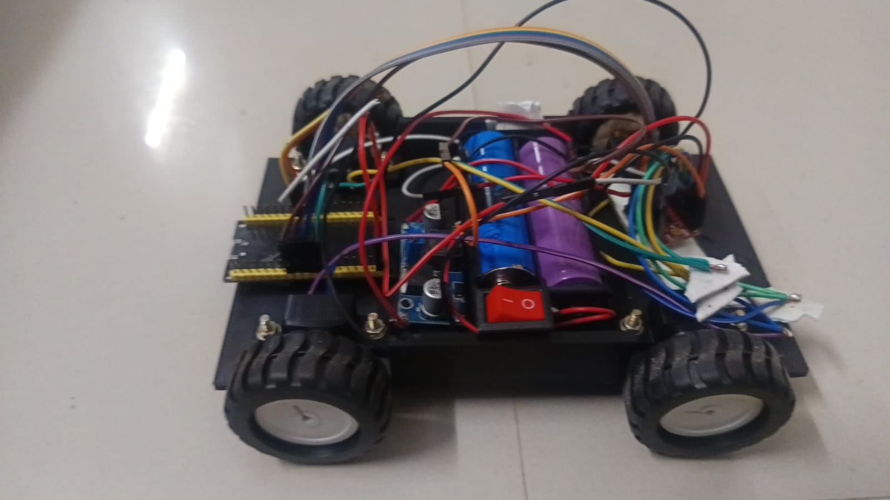
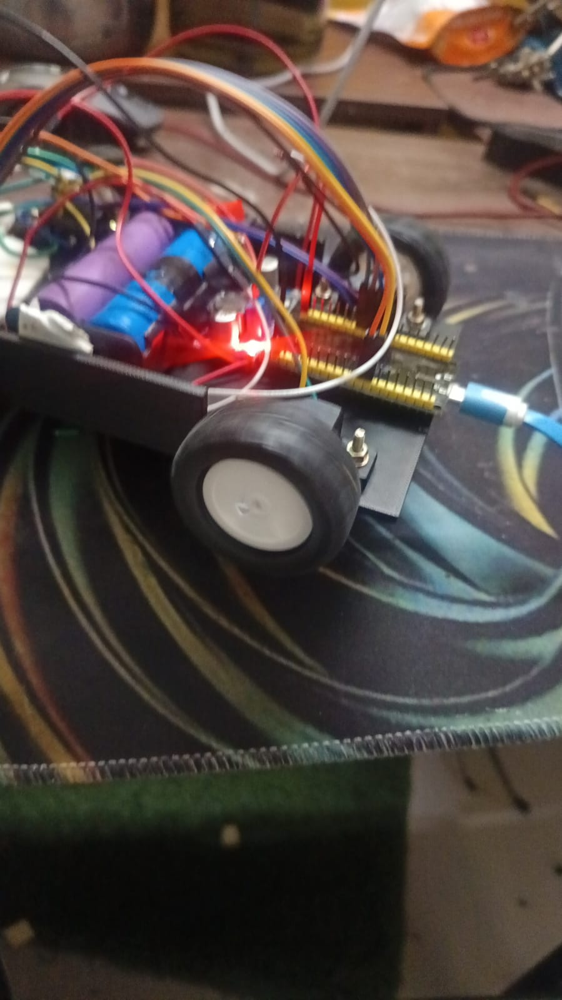
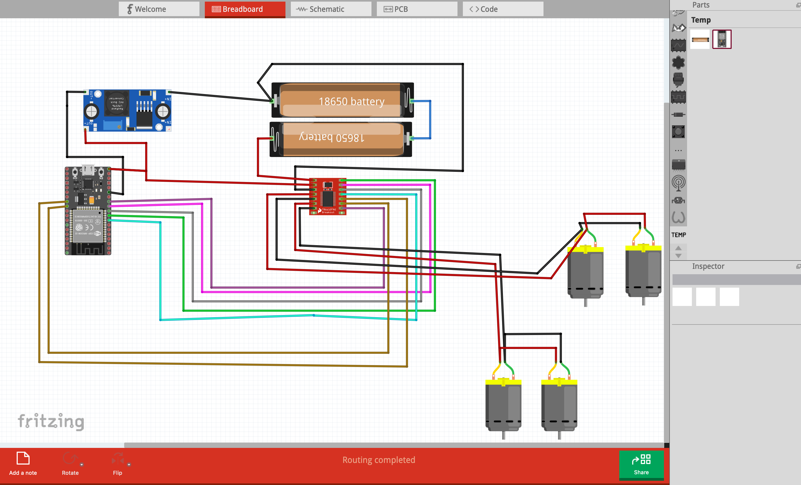
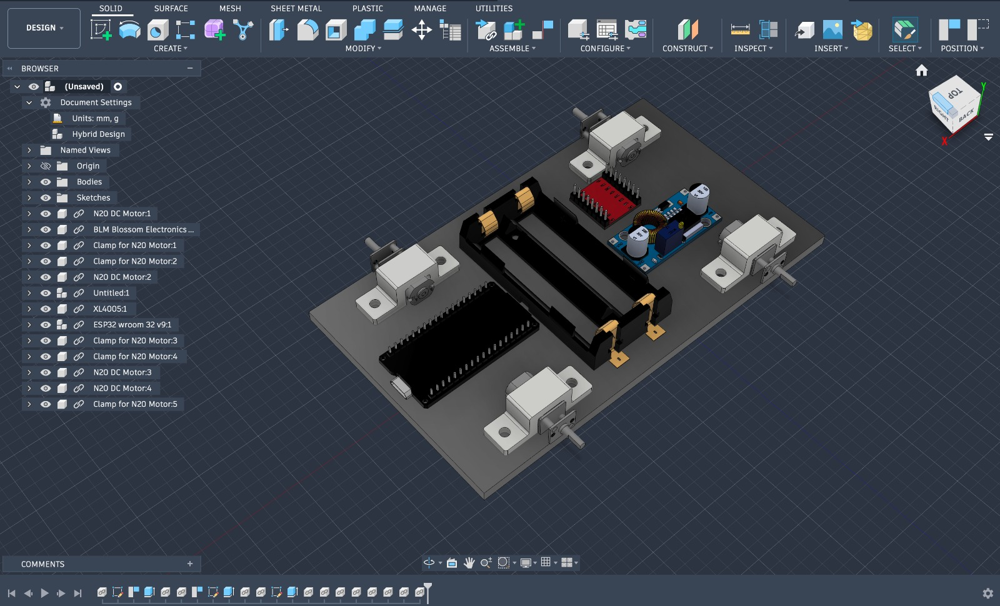

# N20 RC Car

This is my small four-wheel RC car built with an ESP32 and four N20 metal gear motors. I made the ESP32 host its own Wi-Fi network and a simple control webpage, so I can drive the car from a phone or laptop without needing a separate remote.

## What is it?

It is a four-wheel, skid-steer car. The two motors on the left side work together, and the two on the right side work together. By changing each side's direction and speed, the car can move forward and backward and turn left or right.

The webpage has direction buttons and a speed slider, so I can control the car right from a browser.

## Why I built it

I wanted to build something small that was still in the RC car world, but also let me bring together a few things I had been learning: ESP32 programming, motor control, circuit design, and CAD. I liked the idea of making the car controllable through a webpage served directly by the ESP32, then having a real little car I could drive around and test.

## Build photos

## Circuit

I designed the circuit in Fritzing. The project file is included here:

- [Open the Fritzing circuit project](circuit/rc-car.fzz)

## CAD

I designed the chassis parts for the car. The CAD files are in the `cad/` folder.

- [Chassis/body STL](cad/bodyOnly.stl)
- [Clamp STEP file](cad/clamp.step)

## Videos

- [Watch the working video](video/working1.mp4)
- [Watch the full-speed test](video/speedfull.mp4)

## Bill of Materials

The table below lists the parts I used, with the purchase links and prices I had when putting the build together. The full BOM is also available in [`bom.csv`](bom.csv).

| Item | Qty | Unit Cost | Total |
|---|---:|---:|---:|
| [ESP32 development board](https://robocraze.com/products/nodemcu-32-wifi-bluetooth-esp32-development-board30-pin) | 1 | ₹410 | ₹410 |
| [TB6612FNG motor driver](https://robu.in/product/motor-driver-tb6612fng-module-performance-ultra-small-volume-3-pi-matching-performance-ultra-l298n/) | 1 | ₹149 | ₹149 |
| [N20 metal gear motors](https://robokits.co.in/motors/n20-metal-gear-micro-motors/n20-metal-geared-dc-motor/ga12-n20-12v-1000-rpm-all-metal-gear-micro-dc-motor-with-precious-metal-brush) | 4 | ₹310 | ₹1,240 |
| [43 mm rubber wheels](https://robocraze.com/products/43mm-rubber-wheel-tyre-for-n20-gear-motor) | 4 | ₹40 | ₹160 |
| [18650 Li-ion batteries](https://quartzcomponents.com/products/18650-li-ion-rechargeable-battery) | 2 | ₹45 | ₹90 |
| [2-cell 18650 battery holder](https://robu.in/product/2-x-18650-cell-box-without-cover) | 1 | ₹19 | ₹19 |
| [3.3V 2A buck converter](https://robocraze.com/products/7semi-dc-buck-converter-breakout-3-3v-2a-out-ap62301) | 1 | ₹112 | ₹112 |
| Custom-designed chassis and printed parts | 1 set | — | — |
| Wires and connectors | As required | — | — |
| **Total for priced items** | | | **₹2,180** |